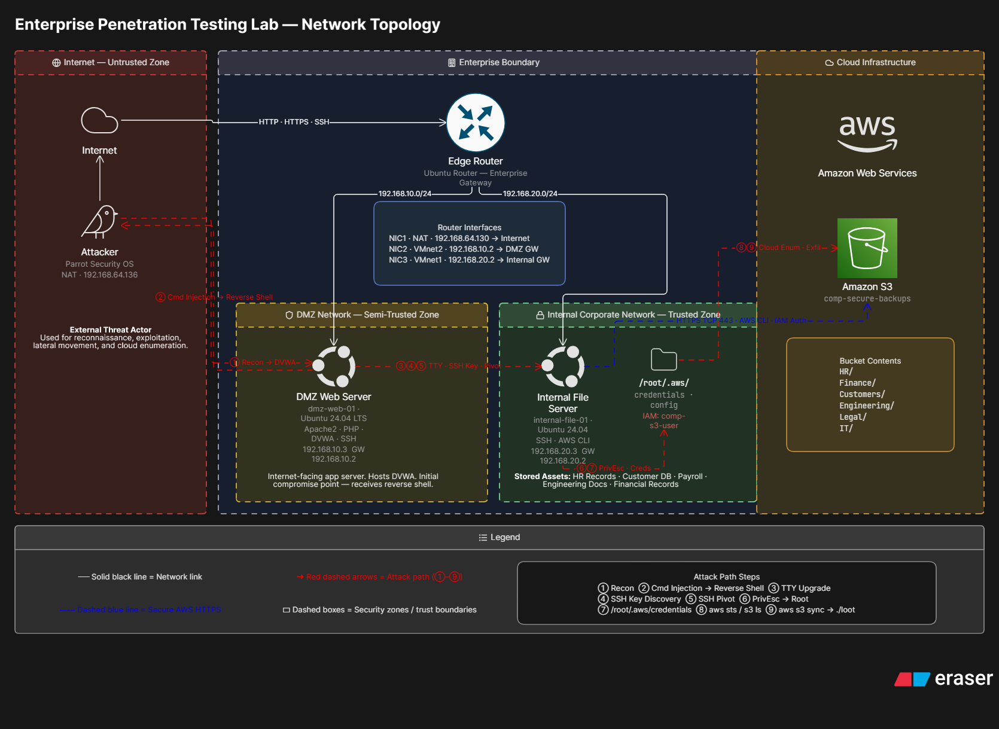

# System Build and Penetration Test

> **A documented vulnerable-network lab build and authorized penetration-test assessment.**

This project records the design of an isolated, intentionally vulnerable network lab, the security assessment performed against it, the evidence collected, and a prioritized remediation plan. It is intended for cybersecurity education and portfolio review—not for use against systems without explicit authorization.

## Project at a glance

| Area | Summary |
| --- | --- |
| **Network build** | Segmented lab with a DMZ web server, an internal Linux host, routing/firewall controls, and a cloud-storage test scenario |
| **Assessment** | Black-box / grey-box infrastructure and web application testing within the lab scope |
| **Coverage** | Reconnaissance, initial access, privilege escalation, lateral movement, cloud credential exposure, and data-access controls |
| **Deliverables** | Architecture and penetration-test reports, extracted figures, findings, and remediation guidance |

## Reports

- [Network architecture report (Word)](reports/network-architecture.docx)
- [Penetration-test report (Word)](reports/penetration-test-report.docx)
- [Penetration-test report — Markdown](reports/penetration-test-report.md)
- [Network architecture — Markdown](reports/network-architecture.md)
- [Extracted figure index](reports/figure-index.md)

The Markdown editions are optimized for reading and navigation on GitHub. The Word originals are included as formatted source deliverables.

## Key findings

The assessment documented eight findings, including command injection, exposed SSH private-key material, unsafe `sudo` permissions, exposed cloud credentials, cloud-storage data exposure, directory listing, default application credentials, and service-version disclosure. The report includes impact, evidence, MITRE ATT&CK mappings, and remediation recommendations for each finding.

## Evidence and redaction

All embedded figures were extracted into [`images/`](images/). AWS access-key and secret-key values were redacted from the public report text and credential screenshot. Other lab credentials are intentionally retained as fictional training values, as confirmed by the author. The supplied source documents remain unchanged in the original folder.

## Responsible use

This is a deliberately vulnerable training environment. Do not reproduce the techniques against production infrastructure, third-party systems, or networks you do not own or have written authorization to test. Treat any real credential or personal information discovered during testing as sensitive: revoke or rotate exposed secrets, remove identifying data before sharing, and follow applicable disclosure and data-protection requirements.

## Suggested next steps

1. Review the Markdown reports and figures for accuracy and any remaining identifying information before publication.
2. Keep the vulnerable lab isolated from public and production networks.
3. Apply the remediation plan and retest each finding.
4. Add sanitized lab configuration files or build notes if you want the repository to be reproducible.

---

**Project:** System Build and Penetration Test  
**Assessment period:** July 2026  
**Status:** Documentation and evidence collection
